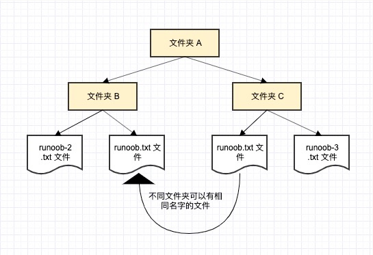

# C++篇基础知识

## 冒号`:`和双冒号`::`的用法

## 单`:`用法

### 1. 表示**机构内位域**的定义（即该变量占几个 bit 空间）

```c++
typedef struct _XXX{
	unsigned char a:4;
	unsigned char c;
}; XXX
```

### 2. **构造函数**后面的冒号起分割作用，是类给**成员变量赋值**的方法，初始化列表，更适用于成员变量的常量 `const` 型。

```c++
// 例1
struct _XXX {
    _XXX() : y(0xc0) {}
};

相当于
struct _XXX {
    _XXX() {
        y = 0xc0;
    }
};

// 例2
class myClass
{
public :
	myClass();// 构造函数，无返回类型，可以有参数列表，这里省去
	~myClass();// 析构函数
	int a;
	const int b;
}

myClass::myClass():a(1),b(1)// 初始化列表
{
}
```

注 1：初始化列表的作用相当于在构造函数内进行相应成员变量的赋值，但两者是有差别的。

在初始化列表中是对变量进行**初始化**，而在构造函数内是进行**赋值操作**。两都的差别在对于像 const 类型数据的操作上表现得尤为明显。我们知道，const 类型的变量必须在定义时进行**初始化**，而不能对 const 型的变量进行**赋值**，因此 const 类型的成员变量**只能（而且必须）**在初始化列表中进行**初始化**，即下面的代码将会出错：

```c++
myClass::myClass()
{
	a = 1;// 没错，效果相当于在初始化列表中进行初始化
	b = 1;// 出错，const变量不能进行赋值操作；
}
```

注 2：初始化的顺序与成员变量声名的顺序相同。

先看一下下面的程序：

```c++
myClass::myClass():b(1),a(b)
{
}
```

这样的执行结果 a,b 各是多少呢？b=1,a=1? 不是，**b=1 而 a 是个随机数**。这一点是相当重要的哦，一般在初始化列表中进行初始化时，初始化的顺序应与声明的顺序保持一致，防止出现不必要的错误。因为C++中成员初始化顺序是按照它们在类中声明的顺序，而不是初始化列表中的顺序。这里声明顺序是int a; const int b; 所以先初始化a，然后b。初始化列表中写b(1), a(b)看似先b后a，但实际顺序是先a后b。当初始化a时，b尚未初始化（因为b在后面声明），所以a(b)使用未初始化的b，导致未定义行为，a得到随机值。之后b被初始化为1。

```c++
class myClass {
public:
    myClass();
    ~myClass();
    const int b;  // 先声明 b
    int a;        // 后声明 a
};

myClass::myClass() : b(1), a(b) {}  // 此时初始化顺序为 b 先，a 后，a 得到 1
```

这样就可以正常初始化

```c++
myClass::myClass():b(1),a(b)
{
}
```

注 3：对于继承的类来说，在初始化列表中也可以进行基类的初始化，初始化的顺序是**先基类初始化**，然后再根据该类自己的变量的声明顺序进行初始化。

### 3. public:` 和 `private:` 后的冒号` 

表示后面定义的所有成员都是公有或私有的，直到下一个 `public:` 或 `private:` 出现为止

### 4. 类名冒号后面的是用来定义类的继承。

```c++
class 派生类名 :继承方式 基类名
{
派生类的成员
};
// 继承方式：public、private和protected，默认处理是public。
```

## 双`::` 用法

`::`是[作用域运算符](https://zhida.zhihu.com/search?content_id=125020941&content_type=Article&match_order=1&q=作用域运算符&zhida_source=entity)，A::B表示作用域A中的-名称B。

类作用域操作符
`::`指明了成员函数所属的类。如：M::f(s)就表示f(s)是类M的成员函数。作用域，如果想在类的外部引用静态成员函数，或在类的外部定义成员函数都要用到。使用命名空间里的类型或函数也要用到（如：std::cout, std::cin, std::string 等等）。

### 1.  表示 **域操作符** / **作用域分解运算符**

```c++
class CA {
public:
  int ca_var;
  int add(int a, int b);
  int add(int a);
};

//那么在实现这个函数时，必须这样书写
int CA::add(int a, int b)
{
  return a + b;
}

//另外，双冒号也常常用于在类变量内部作为当前类实例的元素进行表示，比如:
int CA::add(int a)
{
  return a + ::ca_var;
}
//表示当前类实例中的变量ca_var
```

### 2. **全局作用域**符号：当全局变量在局部函数中与其中某个变量重名，那么就可以用 `::` 来区分如

```c++
char zhou; //全局变量 
void sleep()
{
    char zhou; //局部变量
    zhou(局部变量) = zhou(局部变量) * zhou(局部变量);
    ::zhou(全局变量) =::zhou(全局变量) *zhou(局部变量);
}
```

### 3. 表示引用成员函数及变量，作用域成员运算符

```c++
System::Math::Sqrt()
// 相当于
System.Math.Sqrt()
```

## c++命名空间

假设这样一种情况，当一个班上有两个名叫 Zara 的学生时，为了明确区分它们，我们在使用名字之外，不得不使用一些额外的信息，比如他们的家庭住址，或者他们父母的名字等等。

同样的情况也出现在 C++ 应用程序中。例如，您可能会写一个名为 xyz() 的函数，在另一个可用的库中也存在一个相同的函数 xyz()。这样，编译器就无法判断您所使用的是哪一个 xyz() 函数。

因此，引入了命名空间这个概念，专门用于解决上面的问题，它可作为附加信息来区分不同库中相同名称的函数、类、变量等。使用了命名空间即定义了上下文。本质上，命名空间就是定义了一个范围。

我们举一个计算机系统中的例子，一个文件夹(目录)中可以包含多个文件夹，每个文件夹中不能有相同的文件名，但不同文件夹中的文件可以重名。



### 1.1 定义命名空间

命名空间的定义使用关键字 **namespace**，后跟命名空间的名称，如下所示：

```c++
namespace namespace_name {
   // 代码声明
}
```

为了调用带有命名空间的函数或变量，需要在前面加上命名空间的名称，如下所示：

```c++
name::code;  // code 可以是变量或函数
```

让我们来看看命名空间如何为变量或函数等实体定义范围：

```c++
#include <iostream>
using namespace std;
// 第一个命名空间
namespace first_space{
   void func(){
      cout << "Inside first_space" << endl;
   }
}
// 第二个命名空间
namespace second_space{
   void func(){
      cout << "Inside second_space" << endl;
   }
}
int main ()
{
   // 调用第一个命名空间中的函数
   first_space::func();
   // 调用第二个命名空间中的函数
   second_space::func(); 
   return 0;
}
```

当上面的代码被编译和执行时，它会产生下列结果：

```shell
Inside first_space
Inside second_space
```

### 1.2  using 指令

您可以使用 **using namespace** 指令，这样在使用命名空间时就可以不用在前面加上命名空间的名称。这个指令会告诉编译器，后续的代码将使用指定的命名空间中的名称。

```c++
#include <iostream>
using namespace std;
 
// 第一个命名空间
namespace first_space{
   void func(){
      cout << "Inside first_space" << endl;
   }
}
// 第二个命名空间
namespace second_space{
   void func(){
      cout << "Inside second_space" << endl;
   }
}
using namespace first_space;
int main ()
{
   // 调用第一个命名空间中的函数
   func();  
   return 0;
}
```

当上面的代码被编译和执行时，它会产生下列结果：

```shell
Inside first_space
```

using 指令也可以用来指定命名空间中的特定项目。例如，如果您只打算使用 std 命名空间中的 cout 部分，您可以使用如下的语句：

```c++
using std::cout;
```

随后的代码中，在使用 cout 时就可以不用加上命名空间名称作为前缀，但是 **std** 命名空间中的其他项目仍然需要加上命名空间名称作为前缀，如下所示：

```c++
#include <iostream>
using std::cout;
 
int main ()
{
 
   cout << "std::endl is used with std!" << std::endl;
   
   return 0;
}
```

当上面的代码被编译和执行时，它会产生下列结果：

```shell
std::endl is used with std!
```

**using** 指令引入的名称遵循正常的范围规则。名称从使用 **using** 指令开始是可见的，直到该范围结束。此时，在范围以外定义的同名实体是隐藏的。

### 1.3 using使用方法拓展

拓展：`using namespace` 是累积的，不会覆盖之前的引入，下面是验证代码。

```c++
#include <iostream>
using namespace std;
// 第一个命名空间
namespace first_space{
   void func(){
      cout << "Inside first_space" << endl;
   }
}
// 第二个命名空间
namespace second_space{
   void func(){
      cout << "Inside second_space" << endl;
   }
}
int main ()
{
   // 调用第一个命名空间中的函数
   using namespace first_space;
   func();
   // 调用第二个命名空间中的函数
   using namespace second_space;
   func();
   return 0;
}
```

编译时提示 func函数 命名空间歧义，编译器也无法正常识别。

```c++
abc.cpp: In function ‘int main()’:
abc.cpp:24:8: error: call of overloaded ‘func()’ is ambiguous
   24 |    func();
      |    ~~~~^~
abc.cpp:13:9: note: candidate: ‘void second_space::func()’
   13 |    void func(){
      |         ^~~~
abc.cpp:7:9: note: candidate: ‘void first_space::func()’
    7 |    void func(){
      |         ^~~~
```

遇到这种情况有三种解决办法：

1. 使用完整的限定名

   ```c++
   #include <iostream>
   using namespace std;
   // 第一个命名空间
   namespace first_space{
      void func(){
         cout << "Inside first_space" << endl;
      }
   }
   // 第二个命名空间
   namespace second_space{
      void func(){
         cout << "Inside second_space" << endl;
      }
   }
   int main()
   {
       // 使用第一个命名空间
       first_space::func();
       // 使用第二个命名空间
       second_space::func();
       return 0;
   }
   ```

2. 只引入具体函数，而不是整个命名空间

   ```c++
   #include <iostream>
   using namespace std;
   // 第一个命名空间
   namespace first_space{
      void func(){
         cout << "Inside first_space" << endl;
      }
   }
   // 第二个命名空间
   namespace second_space{
      void func(){
         cout << "Inside second_space" << endl;
      }
   }
   int main()
   {
       using first_space::func;
       func();  // 调用 first_space::func
       
       using second_space::func;
       func();  // 调用 second_space::func（后者覆盖前者）
       return 0;
   }
   ```

3. 用作用域块隔离

   ```c++
   #include <iostream>
   using namespace std;
   // 第一个命名空间
   namespace first_space{
      void func(){
         cout << "Inside first_space" << endl;
      }
   }
   // 第二个命名空间
   namespace second_space{
      void func(){
         cout << "Inside second_space" << endl;
      }
   }
   int main()
   {
       {
           using namespace first_space;
           func();
       }
       {
           using namespace second_space;
           func();
       }
       return 0;
   }
   ```

### 1.4 不连续的命名空间

命名空间可以定义在几个不同的部分中，因此命名空间是由几个单独定义的部分组成的。一个命名空间的各个组成部分可以分散在多个文件中。

所以，如果命名空间中的某个组成部分需要请求定义在另一个文件中的名称，则仍然需要声明该名称。下面的命名空间定义可以是定义一个新的命名空间，也可以是为已有的命名空间增加新的元素：

```c++
namespace namespace_name {
   // 代码声明
}
```

### 1.5 嵌套的命名空间

命名空间可以嵌套，您可以在一个命名空间中定义另一个命名空间，如下所示：

```c++
namespace namespace_name1 {
   // 代码声明
   namespace namespace_name2 {
      // 代码声明
   }
}
```

您可以通过使用 `::` 运算符来访问嵌套的命名空间中的成员：

```c++
// 访问 namespace_name2 中的成员
using namespace namespace_name1::namespace_name2;
 
// 访问 namespace_name1 中的成员
using namespace namespace_name1;
```

在上面的语句中，如果使用的是 namespace_name1，那么在该范围内 namespace_name2 中的元素也是可用的，如下所示：

```c++
#include <iostream>
using namespace std;

// 第一个命名空间
namespace first_space{
   void func(){
      cout << "Inside first_space" << endl;
   }
   // 第二个命名空间
   namespace second_space{
      void func(){
         cout << "Inside second_space" << endl;
      }
   }
}
using namespace first_space::second_space;
int main ()
{
   // 调用第二个命名空间中的函数
   func();
   return 0;
}
```

使用2个命名空间中的函数

```c++
#include <iostream>
using namespace std;

// 第一个命名空间
namespace first_space{
   void func(){
      cout << "Inside first_space" << endl;
   }
   // 第二个命名空间
   namespace second_space{
      void func(){
         cout << "Inside second_space" << endl;
      }
   }
}
int main ()
{
   // 调用第二个命名空间中的函数
   first_space::func();
   first_space::second_space::func();
   return 0;
}
```


参考：https://www.runoob.com/cplusplus/cpp-tutorial.html
