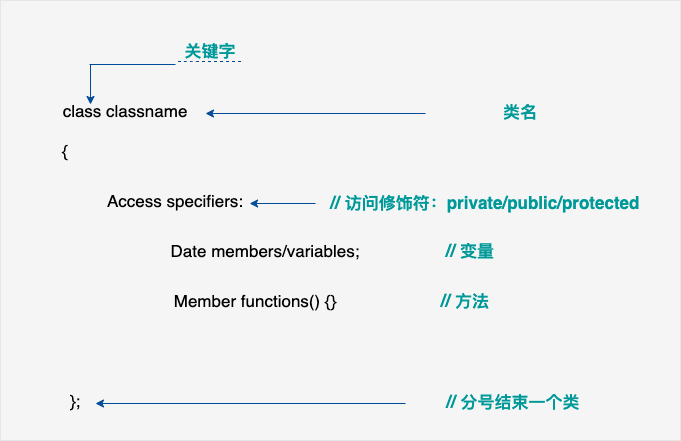
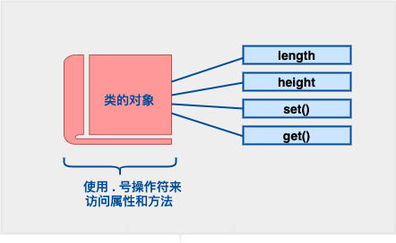
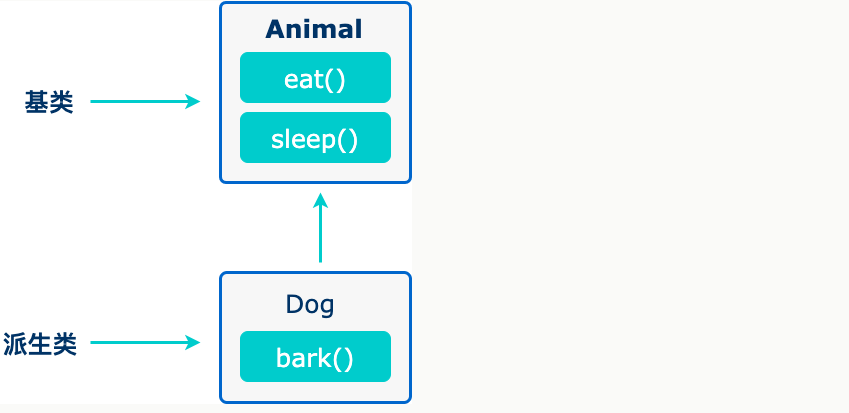

# C++篇类相关

## 1. 类的定义

定义一个类需要使用关键字 **class**，然后指定类的名称，并类的主体是包含在一对花括号中，主体包含类的成员变量和成员函数。

定义一个类，本质上是定义一个数据类型的蓝图，它定义了类的对象包括了什么，以及可以在这个对象上执行哪些操作。



以下实例我们使用关键字 **class** 定义 Box 数据类型，包含了三个成员变量 length、breadth 和 height：

```c++
class Box
{
   public:
      double length;   // 盒子的长度
      double breadth;  // 盒子的宽度
      double height;   // 盒子的高度
};
```

## 2. 声明类对象

```c++
Box Box1;          // 声明 Box1，类型为 Box
Box Box2;          // 声明 Box2，类型为 Box
```

对象 Box1 和 Box2 都有它们各自的数据（长度，宽度，高度）成员。是两个独立的实例化对象。

## 3. 访问数据成员

**类的对象的公共数据成员可以使用直接成员访问运算符  .  来访问。**



为了更好地理解这些概念，让我们尝试一下下面的实例：

```c++
#include <iostream>
 
using namespace std;

class Box
{
   public:
      double length;   // 长度
      double breadth;  // 宽度
      double height;   // 高度
      // 成员函数声明
      double get(void);
      void set( double len, double bre, double hei );
};
// 成员函数定义
double Box::get(void)
{
    return length * breadth * height;
}

void Box::set( double len, double bre, double hei)
{
    length = len;
    breadth = bre;
    height = hei;
}
int main()
{
   Box Box1;        // 声明 Box1，类型为 Box
   Box Box2;        // 声明 Box2，类型为 Box
   Box Box3;        // 声明 Box3，类型为 Box
   double volume = 0.0;     // 用于存储体积

   // box 1 详述
   Box1.height = 5.0;
   Box1.length = 6.0;
   Box1.breadth = 7.0;
 
   // box 2 详述
   Box2.height = 10.0;
   Box2.length = 12.0;
   Box2.breadth = 13.0;
 
   // box 1 的体积
   volume = Box1.height * Box1.length * Box1.breadth;
   cout << "Box1 的体积：" << volume <<endl;
 
   // box 2 的体积
   volume = Box2.height * Box2.length * Box2.breadth;
   cout << "Box2 的体积：" << volume <<endl;
 
   // box 3 详述
   Box3.set(16.0, 8.0, 12.0); 
   volume = Box3.get(); 
   cout << "Box3 的体积：" << volume <<endl;
   return 0;
}
```

需要注意的是，私有的成员和受保护的成员不能使用直接成员访问运算符 (.) 来直接访问。

## 4.  类成员函数

类的成员函数是指那些把定义和原型写在类定义内部的函数，就像类定义中的其他变量一样。类成员函数是类的一个成员，它可以操作类的任意对象，可以访问对象中的所有成员。

让我们看看之前定义的类 Box，现在我们要使用成员函数来访问类的成员，而不是直接访问这些类的成员：

```c++
class Box
{
   public:
      double length;         // 长度
      double breadth;        // 宽度
      double height;         // 高度
      double getVolume(void);// 返回体积
};
```

成员函数可以定义在类定义内部，或者单独使用**范围解析运算符 ::** 来定义。在类定义中定义的成员函数把函数声明为**内联**的，即便没有使用 inline 标识符。所以您可以按照如下方式定义 **getVolume()** 函数：

```c++
class Box
{
   public:
      double length;      // 长度
      double breadth;     // 宽度
      double height;      // 高度
   
      double getVolume(void)
      {
         return length * breadth * height;
      }
};
```

您也可以在类的外部使用**范围解析运算符 ::** 定义该函数，如下所示：

```c++
double Box::getVolume(void)
{
    return length * breadth * height;
}
```

在这里，需要强调一点，在 :: 运算符之前必须使用类名。调用成员函数是在对象上使用点运算符（**.**），这样它就能操作与该对象相关的数据，如下所示：

```c++
Box myBox;          // 创建一个对象
myBox.getVolume();  // 调用该对象的成员函数
```

让我们使用上面提到的概念来设置和获取类中不同的成员的值：

```c++
#include <iostream>
 
using namespace std;
 
class Box
{
   public:
      double length;         // 长度
      double breadth;        // 宽度
      double height;         // 高度
 
      // 成员函数声明
      double getVolume(void);
      void setLength( double len );
      void setBreadth( double bre );
      void setHeight( double hei );
};
 
// 成员函数定义
double Box::getVolume(void)
{
    return length * breadth * height;
}
 
void Box::setLength( double len )
{
    length = len;
}
 
void Box::setBreadth( double bre )
{
    breadth = bre;
}
 
void Box::setHeight( double hei )
{
    height = hei;
}
 
// 程序的主函数
int main( )
{
   Box Box1;                // 声明 Box1，类型为 Box
   Box Box2;                // 声明 Box2，类型为 Box
   double volume = 0.0;     // 用于存储体积
 
   // box 1 详述
   Box1.setLength(6.0); 
   Box1.setBreadth(7.0); 
   Box1.setHeight(5.0);
 
   // box 2 详述
   Box2.setLength(12.0); 
   Box2.setBreadth(13.0); 
   Box2.setHeight(10.0);
 
   // box 1 的体积
   volume = Box1.getVolume();
   cout << "Box1 的体积：" << volume <<endl;
 
   // box 2 的体积
   volume = Box2.getVolume();
   cout << "Box2 的体积：" << volume <<endl;
   return 0;
}
```

## 5. c++继承

面向对象程序设计中最重要的一个概念是继承。继承允许我们依据另一个类来定义一个类，这使得创建和维护一个应用程序变得更容易。这样做，也达到了重用代码功能和提高执行效率的效果。

当创建一个类时，您不需要重新编写新的数据成员和成员函数，只需指定新建的类继承了一个已有的类的成员即可。这个已有的类称为**基类**，新建的类称为**派生类**。

继承代表了 **is a** 关系。例如，哺乳动物是动物，狗是哺乳动物，因此，狗是动物，等等。



```c++
// 基类
class Animal {
    // eat() 函数
    // sleep() 函数
};


//派生类   类名冒号后面的是用来定义类的继承。
class Dog : public Animal {
    // bark() 函数
};
```

### 1. 基类 & 派生类

一个类可以派生自多个类，这意味着，它可以从多个基类继承数据和函数。定义一个派生类，我们使用一个类派生列表来指定基类。类派生列表以一个或多个基类命名，形式如下：

```c++
class derived-class: access-specifier base-class
```

其中，访问修饰符 access-specifier 是 **public、protected** 或 **private** 其中的一个，base-class 是之前定义过的某个类的名称。如果未使用访问修饰符 access-specifier，则默认为 private。

假设有一个基类 **Shape**，**Rectangle** 是它的派生类，如下所示：

```c++
#include <iostream>

using namespace std;

// 基类
class Shape
{
   public:
      void setWidth(int w)
      {
         width = w;
      }
      void setHeight(int h)
      {
         height = h;
      }
   protected:
      int width;
      int height;
};
// 派生类
class Rectangle: public Shape
{
   public:
      int getArea()
      { 
         return (width * height); 
      }
};
int main(void)
{
   Rectangle Rect;

   Rect.setWidth(5);
   Rect.setHeight(7);

   // 输出对象的面积
   cout << "Total area: " << Rect.getArea() << endl;

   return 0;
}
```

### 2. 访问控制和继承

```c++
派生类可以访问基类中所有的非私有成员。因此基类成员如果不想被派生类的成员函数访问，则应在基类中声明为 private。
我们可以根据访问权限总结出不同的访问类型，如下所示：
```

| 访问     | public | protected | private |
| :------- | :----- | :-------- | :------ |
| 同一个类 | yes    | yes       | yes     |
| 派生类   | yes    | yes       | no      |
| 外部的类 | yes    | no        | no      |

一个派生类继承了所有的基类方法，但下列情况除外：

- 基类的构造函数、析构函数和拷贝构造函数。
- 基类的重载运算符。
- 基类的友元函数。

### 3. 继承类型

当一个类派生自基类，该基类可以被继承为 **public、protected** 或 **private** 几种类型。继承类型是通过上面讲解的访问修饰符 access-specifier 来指定的。

我们几乎不使用 **protected** 或 **private** 继承，通常使用 **public** 继承。当使用不同类型的继承时，遵循以下几个规则：

- **公有继承（public）：**当一个类派生自**公有**基类时，基类的**公有**成员也是派生类的**公有**成员，基类的**保护**成员也是派生类的**保护**成员，基类的**私有**成员不能直接被派生类访问，但是可以通过调用基类的**公有**和**保护**成员来访问。
- **保护继承（protected）：** 当一个类派生自**保护**基类时，基类的**公有**和**保护**成员将成为派生类的**保护**成员。
- **私有继承（private）：**当一个类派生自**私有**基类时，基类的**公有**和**保护**成员将成为派生类的**私有**成员。

### 4.  多继承

多继承即一个子类可以有多个父类，它继承了多个父类的特性。

C++ 类可以从多个类继承成员，语法如下：

```c++
class <派生类名>:<继承方式1><基类名1>,<继承方式2><基类名2>,…
{
<派生类类体>
};
```

其中，访问修饰符继承方式是 **public、protected** 或 **private** 其中的一个，用来修饰每个基类，各个基类之间用逗号分隔，如上所示。现在让我们一起看看下面的实例：  

```c++
#include <iostream>

using namespace std;

// 基类 Shape
class Shape 
{
   public:
      void setWidth(int w)
      {
         width = w;
      }
      void setHeight(int h)
      {
         height = h;
      }
   protected:
      int width;
      int height;
};

// 基类 PaintCost
class PaintCost 
{
   public:
      int getCost(int area)
      {
         return area * 70;
      }
};

// 派生类
class Rectangle: public Shape, public PaintCost
{
   public:
      int getArea()
      { 
         return (width * height); 
      }
};

int main(void)
{
   Rectangle Rect;
   int area;

   Rect.setWidth(5);
   Rect.setHeight(7);

   area = Rect.getArea();

   // 输出对象的面积
   cout << "Total area: " << Rect.getArea() << endl;

   // 输出总花费
   cout << "Total paint cost: $" << Rect.getCost(area) << endl;

   return 0;
}
```


参考：https://www.runoob.com/cplusplus/cpp-tutorial.html