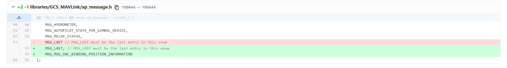
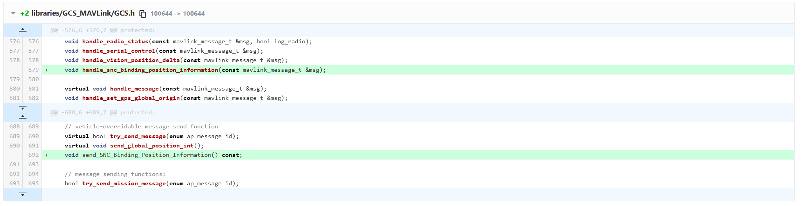
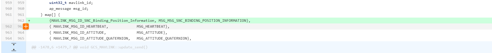
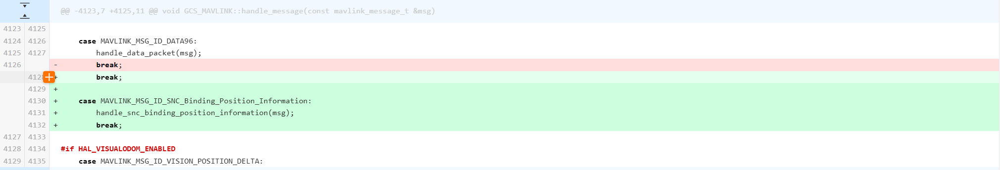
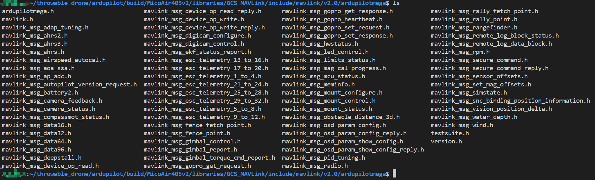
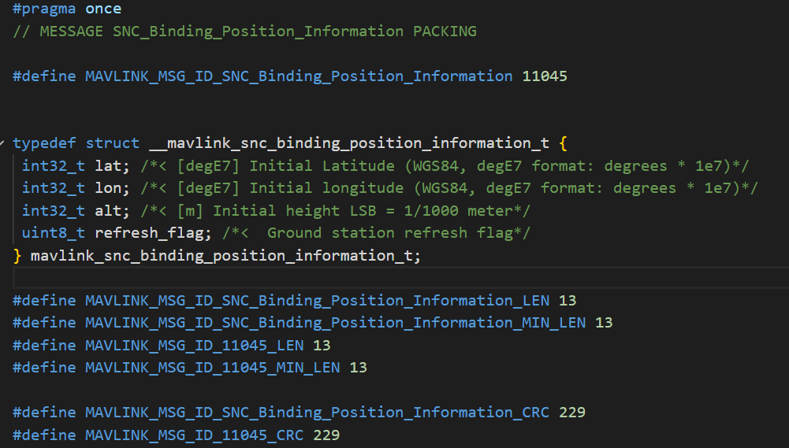
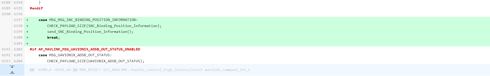

[TOC]

------
# 添加自定义Mavlink

## 1. 在modules/mavlink/message_definitions/v1.0/ardupilotmega.xml文件中添加Mavlink配置文件

```xml
<message id="11045" name="SNC_Binding_Position_Information">
    <description>Initial binding position information</description>
    <field type="int32_t" name="lat" units="degE7">Initial Latitude (WGS84, degE7 format: degrees * 1e7)</field>
    <field type="int32_t" name="lon" units="degE7">Initial longitude (WGS84, degE7 format: degrees * 1e7)</field>
    <field type="int32_t" name="alt" units="m">Initial height LSB = 1/1000 meter</field>
    <field type="uint8_t" name="refresh_flag">Ground station refresh flag</field>
</message>
```

## 2. 重新编译对应的机型代码

在目录 ardupilot/build/MicoAir405v2/libraries/GCS_MAVLink/include/mavlink/v2.0/ardupilotmega 下生成添加协议的头文件。

## 3. 修改 libraries/GCS_MAVLink/ap_message.h 文件



添加新的定义。

## 4.  修改 libraries/GCS_MAVLink/GCS.h

### 4.1. 添加接收和发送请求函数声明



## 5.修改 libraries/GCS_MAVLink/GCS_Common.cpp

### 5.1.将信息添加到MAVLink消息ID与内部消息ID映射的查找表map[]中



### 5.2. 解析Mavlink消息部分

#### 5.2.1. 在函数 void GCS_MAVLINK::handle_message(const mavlink_message_t &msg) 中添加新的处理分支逻辑



#### 5.2.2. 其中   MAVLINK_MSG_ID_SNC_Binding_Position_Information  就是新编译头文件中的协议标识。

对应map[]中的  {MAVLINK_MSG_ID_SNC_Binding_Position_Information, MSG_MSG_SNC_BINDING_POSITION_INFORMATION},   

前半句





### 5.3. 发送协议部分

#### 5.3.1. 添加发送消息新增mavlink消息的分支



#### 5.3.2. 其中的 MSG_MSG_SNC_BINDING_POSITION_INFORMATION 也就是在ap_message.h中新增的字段。

对应map[]中的  {MAVLINK_MSG_ID_SNC_Binding_Position_Information, MSG_MSG_SNC_BINDING_POSITION_INFORMATION},   

后半句。

### 5.4. 发送和接收函数的实现

直接粘代码

```c++
void GCS_MAVLINK::send_SNC_Binding_Position_Information() const
{
#if AP_AHRS_ENABLED
    AP_AHRS &ahrs = AP::ahrs();
    Location loc;
    
    // 获取当前位置
    if (!ahrs.get_location(loc)) {
        // 如果没有有效位置，返回
        return;
    }
    
    // 获取高度并转换单位
    // loc.alt 单位是厘米
    // 消息定义：alt 的单位是米，LSB = 1/1000 米（即 1 代表 0.001 米）
    // 转换：厘米 -> 米 -> 消息单位（米*1000）
    // 例如：1000 厘米 = 10 米 = 10000 消息单位
    int32_t alt_m = loc.alt * 10;  // 厘米转米再乘以1000：loc.alt(厘米) / 100 * 1000 = loc.alt * 10
    
    // 发送 SNC_Binding_Position_Information 消息
    // lat 和 lon 已经是 degE7 格式（度 * 1e7）
    // alt 需要转换为米，LSB = 1/1000 米
    // refresh_flag 设置为 0（可以根据需要修改）
    mavlink_msg_snc_binding_position_information_send(
        chan,
        loc.lat,        // 纬度 (degE7格式)
        loc.lng,        // 经度 (degE7格式)
        alt_m,          // 高度 (米，LSB = 1/1000米)
        0               // 刷新标志
    );
#endif  // AP_AHRS_ENABLED
}

void GCS_MAVLINK::handle_snc_binding_position_information(const mavlink_message_t &msg)
{
    // 解码接收到的消息
    mavlink_snc_binding_position_information_t packet;
    mavlink_msg_snc_binding_position_information_decode(&msg, &packet);
    
    // 提取消息字段
    int32_t lat = packet.lat;           // 纬度 (degE7格式)
    int32_t lon = packet.lon;           // 经度 (degE7格式)
    int32_t alt = packet.alt;           // 高度 (米，LSB = 1/1000米)
    uint8_t refresh_flag = packet.refresh_flag;  // 刷新标志
    
    // 这里可以添加处理逻辑，例如：
    // - 设置初始位置
    // - 更新绑定位置
    // - 根据 refresh_flag 执行相应操作
    
    // 示例：打印接收到的位置信息（仅在调试时使用）
    gcs().send_text(MAV_SEVERITY_INFO, "Received SNC binding position: lat=%ld lon=%ld alt=%ld flag=%u", 
                    lat, lon, alt, refresh_flag);
    
    // 如果需要设置初始位置，可以使用：
    // Location loc;
    // loc.lat = lat;
    // loc.lng = lon;
    // loc.alt = alt * 10;  // 转换为厘米
    // set_home(loc, false);
}
```

🌺🌺🌺🌺🌺完结🌸🌸🌸🌸
